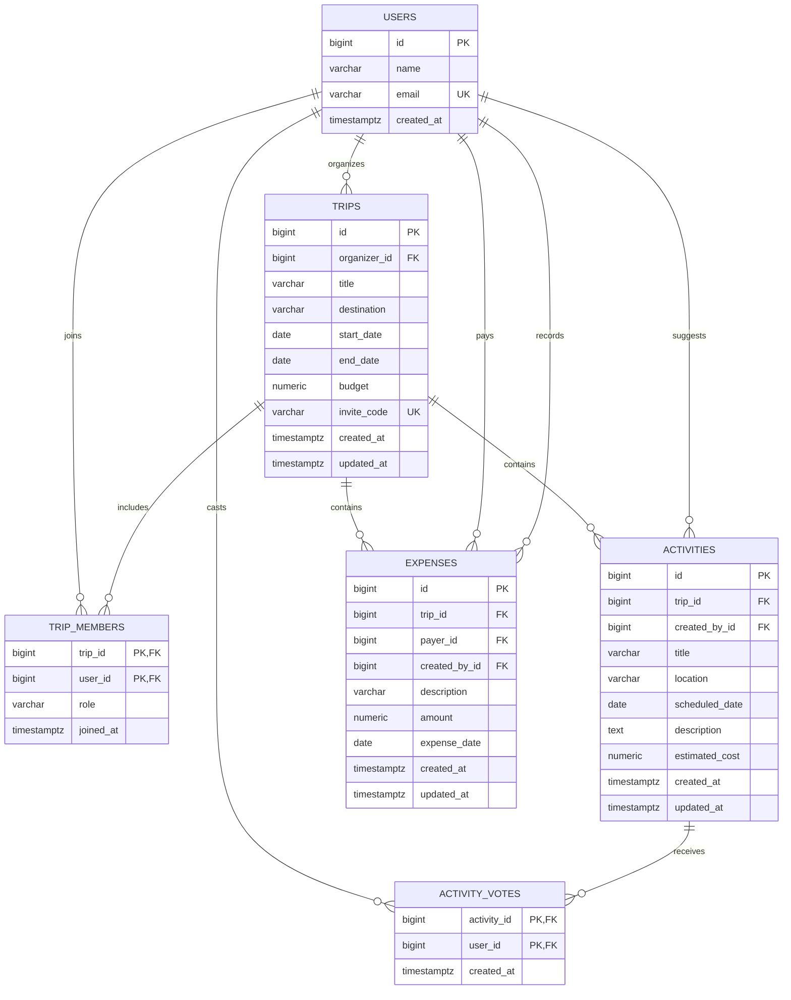

# TripTogether Entity Relationship Diagram

This ERD supports the TripTogether user stories, Figma wireframes, voting rules, activity ownership, and shared-expense workflows.

## ER diagram

## Tables and rules

### `users`

Stores the people who can organize trips, join trips, suggest activities, vote, and pay or record expenses.

- `email` is unique.
- Authentication is outside the initial scope; the seeded demo-user selector supplies the active user during development.

### `trips`

Stores the shared trip details.

- `organizer_id` references `users.id`.
- `invite_code` is unique and not nullable.
- `budget` must be nonnegative.
- `start_date` must be on or before `end_date`.
- The organizer should also have a corresponding `trip_members` row with `role = 'organizer'`.

### `trip_members`

Joins users to trips and stores the user’s role for that specific trip.

- Composite primary key: `(trip_id, user_id)`.
- `role` is either `organizer` or `member`.
- A user can organize one trip and be a member of another.
- A trip can have many members.
- The organizer cannot be removed from the trip.

### `activities`

Stores activity suggestions and itinerary items.

- `trip_id` identifies the trip.
- `created_by_id` identifies the user who suggested the activity.
- `scheduled_date` is nullable so activities can remain unscheduled.
- `estimated_cost` must be nonnegative.
- The API should allow editing and deleting only by the activity creator or an authorized organizer.

### `activity_votes`

Joins users to activities they voted for.

- Composite primary key: `(activity_id, user_id)`.
- The composite key allows at most one vote per user per activity.
- A vote can be inserted only when the user belongs to the activity’s trip.
- Votes are removed when a user removes their vote or when the related activity is deleted.

### `expenses`

Stores shared trip expenses.

- `payer_id` identifies the person who actually paid.
- `created_by_id` identifies the person who entered the expense. These may be different users.
- `amount` must be greater than zero.
- Expense records contribute to the trip’s total spending.
- The API should allow editing and deleting only by the expense creator or an authorized organizer.

## Recommended foreign-key behavior

| Relationship | Recommended behavior |
|---|---|
| `trips.organizer_id -> users.id` | `RESTRICT` |
| `trip_members.trip_id -> trips.id` | `CASCADE` |
| `trip_members.user_id -> users.id` | `RESTRICT` |
| `activities.trip_id -> trips.id` | `CASCADE` |
| `activities.created_by_id -> users.id` | `RESTRICT` |
| `activity_votes.activity_id -> activities.id` | `CASCADE` |
| `activity_votes.user_id -> users.id` | `CASCADE` |
| `expenses.trip_id -> trips.id` | `CASCADE` |
| `expenses.payer_id -> users.id` | `RESTRICT` |
| `expenses.created_by_id -> users.id` | `RESTRICT` |

Deleting a trip therefore removes its memberships, activities, votes, and expenses. Deleting users is intentionally restricted so historical expense and activity ownership remains valid.

## Validation that belongs in the API

The database constraints handle uniqueness, required values, numeric limits, and trip date order. The Express API should additionally validate:

1. The active user belongs to the trip before allowing activity, vote, or expense operations.
2. An activity’s scheduled date is within the trip dates when a date is provided.
3. Only the activity creator or an authorized organizer can edit or delete an activity.
4. Only the expense creator or an authorized organizer can edit or delete an expense.
5. Only the organizer can edit trip settings, regenerate an invite code, remove members, or delete the trip.
6. The organizer cannot remove themself from the trip.

