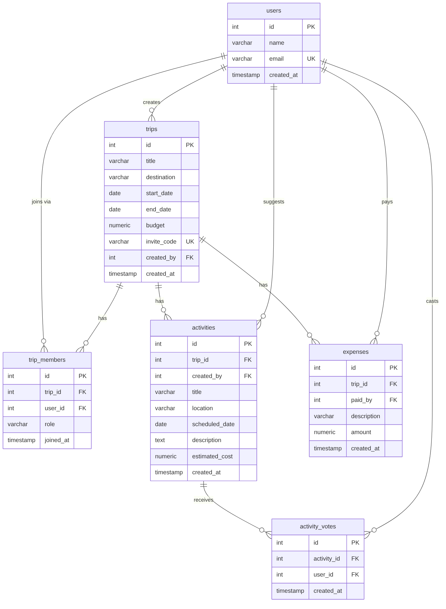

# Entity Relationship Diagram

## Create the List of Tables

1. `users`
2. `trips`
3. `trip_members` (join table: users and trips, many-to-many)
4. `activities`
5. `activity_votes` (join table: users and activities, many-to-many)
6. `expenses`

## Add the Entity Relationship Diagram

### Relationships

- One-to-many: `trips` to `activities`, `trips` to `expenses`, `users` to `trips` (creator).
- Many-to-many: `users` and `trips` through `trip_members`, which also stores the member's `role` (`organizer` or `member`).
- Many-to-many: `users` and `activities` through `activity_votes`.

### Table Details

**users**

| Column Name | Type | Description |
|-------------|------|-------------|
| id | serial | primary key |
| name | varchar | display name |
| email | varchar | unique |
| created_at | timestamp | defaults to now |

**trips**

| Column Name | Type | Description |
|-------------|------|-------------|
| id | serial | primary key |
| title | varchar | required |
| destination | varchar | required |
| start_date | date | required |
| end_date | date | required, on or after start_date |
| budget | numeric(10,2) | nonnegative |
| invite_code | varchar | unique, used to join the trip |
| created_by | integer | foreign key to users.id |
| created_at | timestamp | defaults to now |

**trip_members**

| Column Name | Type | Description |
|-------------|------|-------------|
| id | serial | primary key |
| trip_id | integer | foreign key to trips.id, on delete cascade |
| user_id | integer | foreign key to users.id |
| role | varchar | `organizer` or `member` |
| joined_at | timestamp | defaults to now |

Unique constraint on `(trip_id, user_id)`.

**activities**

| Column Name | Type | Description |
|-------------|------|-------------|
| id | serial | primary key |
| trip_id | integer | foreign key to trips.id, on delete cascade |
| created_by | integer | foreign key to users.id |
| title | varchar | required |
| location | varchar | optional |
| scheduled_date | date | optional, must fall within the trip dates |
| description | text | optional |
| estimated_cost | numeric(10,2) | nonnegative |
| created_at | timestamp | defaults to now |

**activity_votes**

| Column Name | Type | Description |
|-------------|------|-------------|
| id | serial | primary key |
| activity_id | integer | foreign key to activities.id, on delete cascade |
| user_id | integer | foreign key to users.id |
| created_at | timestamp | defaults to now |

Unique constraint on `(user_id, activity_id)` so each participant gets one vote per activity.

**expenses**

| Column Name | Type | Description |
|-------------|------|-------------|
| id | serial | primary key |
| trip_id | integer | foreign key to trips.id, on delete cascade |
| paid_by | integer | foreign key to users.id |
| description | varchar | required |
| amount | numeric(10,2) | must be greater than 0 |
| created_at | timestamp | defaults to now |
