# Wireframes

**Team:** Yugant Nagralawala, Arnold Waigwa, Yingshu Wang

**Figma file:** [TripTogether wireframes](https://www.figma.com/design/lmCzu29AM6dYbE5vx587AV)

We designed TripTogether in Figma before writing any frontend code. Every screen below is an editable Figma frame built from shared components, so when we change a button or an activity row once, every screen picks up the change. Each section links to its frame in the file.

The wireframes are mid to high fidelity. We chose that level on purpose: the layout, copy, validation messages and numbers on these screens are what we plan to build, so the frontend can be implemented straight from them.

## Contents

1. [How we designed these screens](#how-we-designed-these-screens)
2. [Sample data used on every screen](#sample-data-used-on-every-screen)
3. [List of pages](#list-of-pages)
4. [Wireframe 1: All Trips](#wireframe-1-all-trips)
5. [Wireframe 2: Join Trip Dialog](#wireframe-2-join-trip-dialog)
6. [Wireframe 3: New Trip](#wireframe-3-new-trip)
7. [Wireframe 4: Itinerary](#wireframe-4-itinerary)
8. [Wireframe 5: Add or Edit Activity](#wireframe-5-add-or-edit-activity)
9. [Wireframe 6: Expenses](#wireframe-6-expenses)
10. [Wireframe 7: Trip Settings](#wireframe-7-trip-settings)
11. [Wireframe 8: Phone layouts](#wireframe-8-phone-layouts)
12. [Wireframe 9: States](#wireframe-9-states)
13. [Wireframe 10: User flow](#wireframe-10-user-flow)
14. [Shared components](#shared-components)
15. [Design tokens](#design-tokens)
16. [API calls by screen](#api-calls-by-screen)
17. [Decisions and open questions](#decisions-and-open-questions)

---

## How we designed these screens

We agreed on a few rules early and applied them to every frame.

- **Color is for data only.** The interface itself is ink and grey. The primary button is near-black. A single blue marks the most important data on a screen: votes on the itinerary and money spent on the expenses page. Red is reserved for errors and destructive actions.
- **Each screen answers one question first.** A short finding line under the page title states the answer, for example "Dinner at Time Out Market leads with 4 of 4 votes. 3 ideas still need your vote."
- **You always know where you are.** The sidebar always shows the product name, the trip you are in and the demo user you are acting as.
- **Every block has its other states designed.** Loading, error and empty versions are in Wireframe 9, so nobody has to invent them during implementation.
- **The numbers add up.** All screens use the same sample trip, so totals on one screen match the rows on another. This doubles as a check on our database design.

The demo-user selector at the bottom of the sidebar replaces login for this version. It switches which seeded user is active, so we can show organizer and member views during the demo. It does not provide real access control.

---

## Sample data used on every screen

This is also the data we plan to load with the database seed script.

**Trip:** Lisbon Long Weekend, Lisbon, Portugal, Mar 12 to Mar 16, 2027. Budget $2,400.00. Invite code `LSB-4K9Q`.

**Members:** Yugant (organizer, and the active demo user in every wireframe), Arnold, Yingshu and Sam.

| Day | Activity | Location | Est. cost | Added by | Votes |
|-----|----------|----------|----------:|----------|------:|
| Fri, Mar 12 | Alfama walking tour | Alfama | $25.00 | Arnold | 3 |
| Fri, Mar 12 | Dinner at Time Out Market | Cais do Sodré | $40.00 | Yugant | 4 |
| Sat, Mar 13 | Day trip to Sintra | Sintra | $60.00 | Yingshu | 2 |
| Sat, Mar 13 | Pastéis de Belém stop | Belém | $12.00 | Sam | 3 |
| Sun, Mar 14 | Tram 28 ride | Graça to Estrela | $4.00 | Sam | 1 |
| Sun, Mar 14 | LX Factory browse | Alcântara | $0.00 | Arnold | 2 |
| Unscheduled | Fado night | Alfama | $45.00 | Yingshu | 1 |

That is 7 activities, 16 votes (4 from each member) and $186.00 of planned costs. Yugant has not voted on Alfama walking tour, Tram 28 ride or Fado night, which is where "3 ideas still need your vote" comes from.

| Expense | Paid by | Added | Amount |
|---------|---------|-------|-------:|
| Time Out Market group booking | Yingshu | 2026-10-18 | $165.00 |
| Sintra train and entry tickets | Sam | 2026-10-15 | $240.00 |
| Airport transfer, prepaid | Arnold | 2026-10-09 | $85.00 |
| Airbnb deposit | Yugant | 2026-10-02 | $660.00 |
| **Total** | | | **$1,150.00** |

$1,150.00 is 48% of the budget. After the $186.00 of planned activities, $1,064.00 is left.

**Other trips for Yugant:** Smoky Mountains Cabin (Gatlinburg, TN, Jun 4 to Jun 7, 2027, $780.00 of $1,800.00, 6 members, 2 ideas need his vote) and Tokyo Food Tour (Tokyo, Japan, Oct 2 to Oct 12, 2027, $0.00 of $4,500.00, 3 members, no activities yet). He is a member of both.

---

## List of pages

| # | Page | Route | Page component | User stories |
|---|------|-------|----------------|--------------|
| 1 | ⭐ All Trips | `/trips` | `TripsPage` | 6 |
| 2 | ⭐ Join Trip Dialog | dialog over `/trips` | `JoinTripDialog` | 5 |
| 3 | ⭐ New Trip | `/trips/new` | `CreateTripPage` | 1, 4 |
| 4 | ⭐ Itinerary | `/trips/:tripId` | `TripDetailsPage` | 4, 6, 9, 10, 11 |
| 5 | ⭐ Add or Edit Activity | slide-over on `/trips/:tripId` | `ActivityFormSheet` | 7, 8 |
| 6 | ⭐ Expenses | `/trips/:tripId/expenses` | `ExpensesPage` | 12 |
| 7 | ⭐ Trip Settings | `/trips/:tripId/settings` | `TripSettingsPage` | 2, 3, 4 |
| 8 | ⭐ Phone layouts | All Trips, Itinerary, Add Activity, Expenses at 390px | same components | all |
| 9 | ⭐ States | loading, error, empty, first run, vote states, over budget, confirm delete, not found | shared components | 3, 9 |
| 10 | ⭐ User flow | how the pages connect | | all |

User story numbers refer to [user_stories.md](user_stories.md).

Our README lists three routes. While designing we added two more: `/trips/new` gives the create form its own page, and `/trips/:tripId/settings` keeps organizer-only actions off the itinerary. We will update the README's frontend section to match.

---

## Wireframe 1: All Trips

**Route:** `/trips` · **Components:** `TripsPage`, `TripCard`, `JoinTripDialog` · **Figma:** [01 All Trips](https://www.figma.com/design/lmCzu29AM6dYbE5vx587AV?node-id=6-196)

**Question it answers:** Which of my trips needs attention? The finding line says Lisbon is 139 days away and 5 ideas across all trips are waiting for your vote.

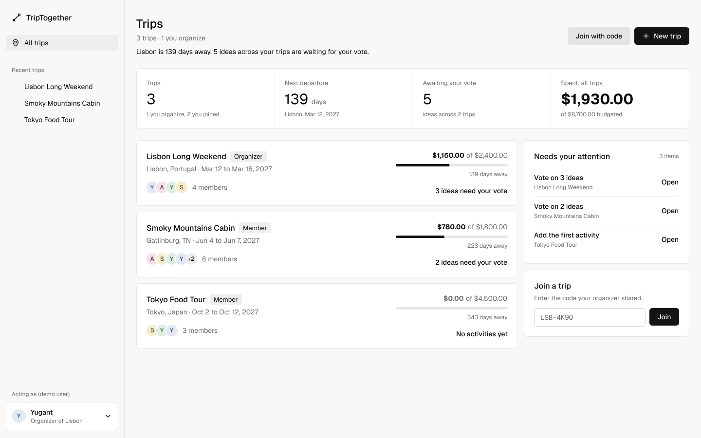

**Layout**

- Header with the page title, a count line ("3 trips · 1 you organize"), the finding line, and two actions: Join with code (secondary) and New trip (primary).
- Summary strip with four figures: Trips (3), Next departure (139 days), Awaiting your vote (5) and Spent across all trips ($1,930.00 of $8,700.00).
- Trip list on the left. Each `TripCard` shows the title, your role badge, destination and dates, member avatars, money spent against budget with a progress bar, days until departure, and the next thing to do.
- Right column with "Needs your attention" (trips with unvoted ideas or no activities, each with an Open link) and an inline Join a trip field.

**Data and interactions**

- `GET /api/trips?userId=` returns the trips the active user belongs to through `trip_members`, with role, member count, spent total and unvoted count.
- Clicking a card opens `/trips/:tripId`. New trip goes to `/trips/new`. Join with code opens Wireframe 2. The inline Join field does the same without the dialog.
- Changing the demo user in the sidebar reloads this list for that user.

---

## Wireframe 2: Join Trip Dialog

**Route:** dialog over `/trips` · **Component:** `JoinTripDialog` · **Figma:** [02 Join Trip Dialog](https://www.figma.com/design/lmCzu29AM6dYbE5vx587AV?node-id=8-574)

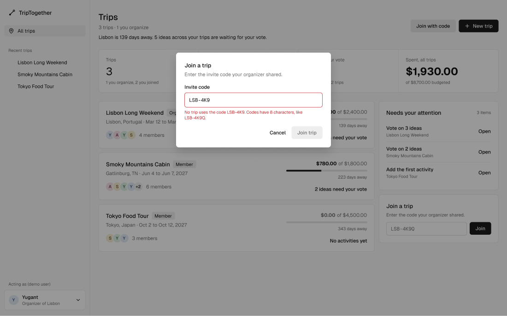

**Interactions and validation**

- One field: the invite code, shown in a monospace font so characters like 0 and O are easy to tell apart.
- `POST /api/trips/join` with `{ inviteCode }`. On success the server adds a `trip_members` row with role `member` and we redirect to the trip.
- The Join trip button stays disabled until the code has 8 characters.
- An unknown code shows the error under the field: "No trip uses the code LSB-4K9. Codes have 8 characters, like LSB-4K9Q."
- Joining a trip you already belong to opens that trip. The unique `(trip_id, user_id)` constraint prevents duplicate memberships.
- Cancel and Escape close the dialog. Focus returns to the button that opened it.

---

## Wireframe 3: New Trip

**Route:** `/trips/new` · **Components:** `CreateTripPage`, `TripForm` · **Figma:** [03 New Trip](https://www.figma.com/design/lmCzu29AM6dYbE5vx587AV?node-id=8-828)

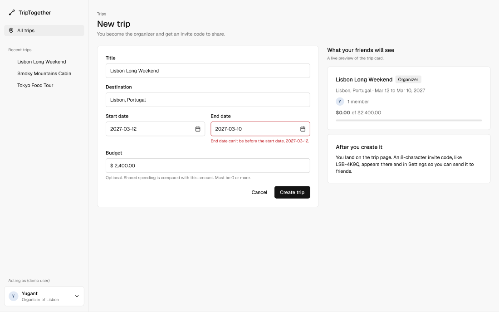

**Layout**

- The form on the left: Title, Destination, Start date, End date and Budget.
- On the right, a live preview of the trip card exactly as friends will see it, plus a short note explaining what happens after you create the trip.

**Validation (custom feature: server-side validation)**

- Title, destination, start date and end date are required.
- The end date cannot be before the start date. The frame shows this error: "End date can't be before the start date, 2027-03-12."
- Budget is optional and must be 0 or more.
- The server returns errors per field and the form shows each one under its field. The client checks the same rules on blur, but the server is the source of truth.

**On success**

- `POST /api/trips` creates the trip, generates an 8-character `invite_code`, and adds the creator to `trip_members` as `organizer`.
- We redirect to `/trips/:tripId`, as planned in the README.

---

## Wireframe 4: Itinerary

**Route:** `/trips/:tripId` · **Components:** `TripDetailsPage`, `DayTabs`, `ActivityList`, `ActivityCard`, `VoteButton`, `MemberList`, `InviteCode` · **Figma:** [04 Itinerary](https://www.figma.com/design/lmCzu29AM6dYbE5vx587AV?node-id=6-696)

**Question it answers:** What is the group doing each day, and what is most popular? The finding line names the leading activity and how many ideas still need your vote.

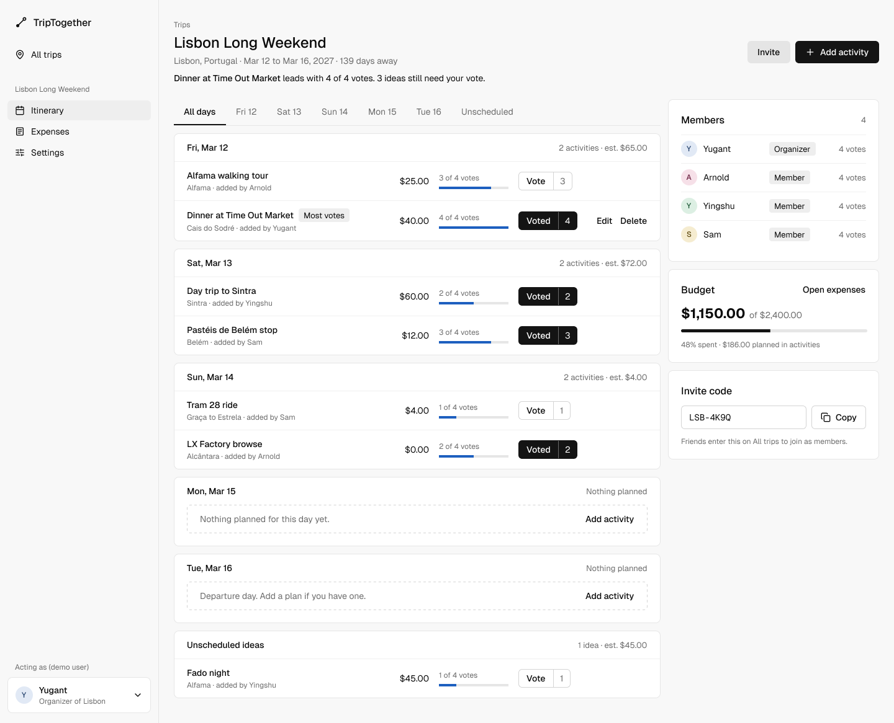

**Layout**

- Header: breadcrumb, trip title, destination and dates, the finding line, and two actions: Invite (secondary) and Add activity (primary).
- Day tabs: All days, Fri 12, Sat 13, Sun 14, Mon 15, Tue 16 and Unscheduled.
- One card per day. The header shows the day, the activity count and the estimated total for that day. Activities without a date are grouped under Unscheduled ideas.
- Each activity row has the title (with a "Most votes" badge on the leader), the location and who added it, the estimated cost, a vote meter ("3 of 4 votes"), the vote button, and Edit and Delete on your own activities only.
- Right column: Members (role and votes cast), a Budget snapshot that links to Expenses, and the Invite code with Copy.

**Custom feature: filtering by date**

- The day tabs filter the list to one date without leaving the page. All days is the default.
- The selected tab is stored in the URL (for example `?date=2027-03-13`) so a filtered view can be shared and survives a refresh.

**Voting**

- Vote calls `POST /api/activities/:activityId/votes`. Voted calls `DELETE /api/activities/:activityId/votes` to remove the vote.
- The count and the blue meter update right away. If the request fails, they roll back and show an error.
- The unique `(user_id, activity_id)` constraint enforces one vote per member per activity.

**Other interactions**

- Days with no activities keep their card and show "Add activity", which opens the sheet with that date already filled in.
- Edit and Delete call `PATCH` and `DELETE /api/activities/:activityId`. Delete asks for confirmation first.

---

## Wireframe 5: Add or Edit Activity

**Route:** slide-over on `/trips/:tripId` · **Component:** `ActivityFormSheet` · **Figma:** [05 Add Activity](https://www.figma.com/design/lmCzu29AM6dYbE5vx587AV?node-id=7-592)

We use a slide-over instead of a separate page so the itinerary stays visible behind the form and the group's context is not lost.

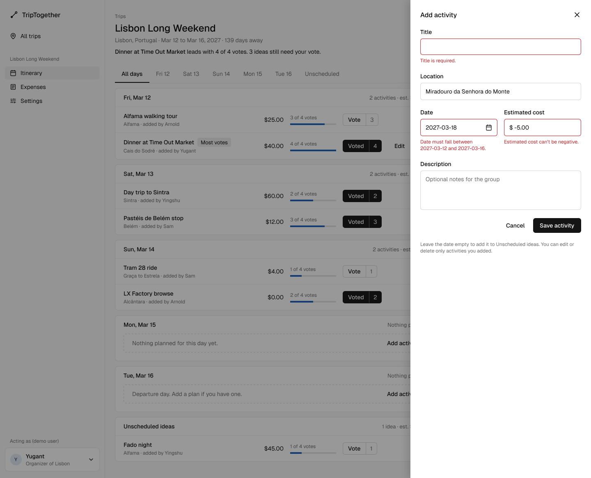

**Fields:** Title, Location, Date, Estimated cost and Description.

**Validation (custom feature: server-side validation)**

- Title is required.
- The date is optional. If it is set, it must fall between the trip's start and end dates.
- Estimated cost cannot be negative.
- The frame shows all three errors at once so we have the exact copy: "Title is required.", "Date must fall between 2027-03-12 and 2027-03-16." and "Estimated cost can't be negative."

**Behavior**

- Adding calls `POST /api/trips/:tripId/activities`. Editing opens the same sheet filled in and calls `PATCH /api/activities/:activityId`.
- An empty date saves the activity under Unscheduled ideas.
- The help text reminds people that they can edit or delete only activities they added.
- Cancel, the close button and Escape all close the sheet without saving.

---

## Wireframe 6: Expenses

**Route:** `/trips/:tripId/expenses` · **Components:** `ExpensesPage`, `BudgetBar`, `ExpenseList`, `ExpenseForm` · **Figma:** [06 Expenses](https://www.figma.com/design/lmCzu29AM6dYbE5vx587AV?node-id=7-591)

**Question it answers:** How much of the budget is gone? The finding line gives the answer in one sentence: "$1,150.00 spent, 48% of the $2,400.00 budget. $1,064.00 remains after $186.00 of planned activities."

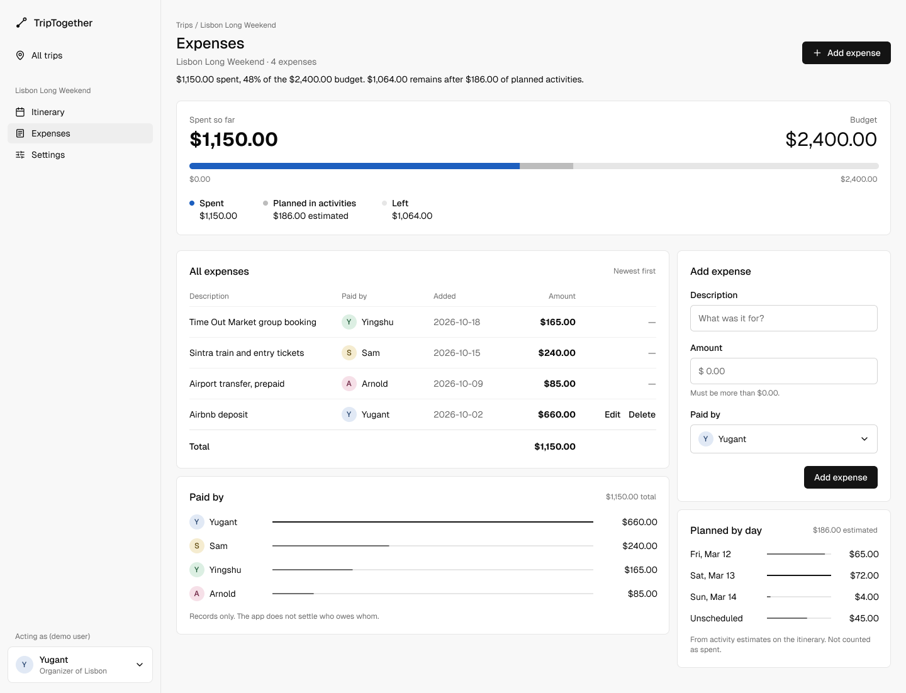

**Layout**

- Budget overview: spent so far against the budget, and one bar split into spent (blue), planned in activities (grey) and left (track).
- All expenses table: description, who paid, date added, amount, and Edit and Delete on your own rows. A total row closes the table.
- Paid by: one thin bar per member showing how much each person has paid.
- Right column: the Add expense form and Planned by day, which sums activity estimates per day ($65.00, $72.00, $4.00 and $45.00 unscheduled).

**Data and validation**

- `GET /api/trips/:tripId/expenses` and `POST /api/trips/:tripId/expenses`. Editing and deleting use `PATCH` and `DELETE /api/expenses/:expenseId`.
- The total is summed from the rows: $660.00 + $85.00 + $165.00 + $240.00 = $1,150.00.
- Amount must be more than $0.00, and Paid by defaults to the active user.
- Planned costs come from the itinerary and are not counted as spent.
- Working out who owes whom is out of scope for this version, and the page says so under Paid by.

---

## Wireframe 7: Trip Settings

**Route:** `/trips/:tripId/settings` · **Components:** `TripSettingsPage`, `TripForm`, `InviteCode`, `MemberList`, `ConfirmDialog` · **Figma:** [07 Trip Settings](https://www.figma.com/design/lmCzu29AM6dYbE5vx587AV?node-id=8-1028)

Only the organizer can open this page. Members who follow a direct link see the trip-not-found state instead.

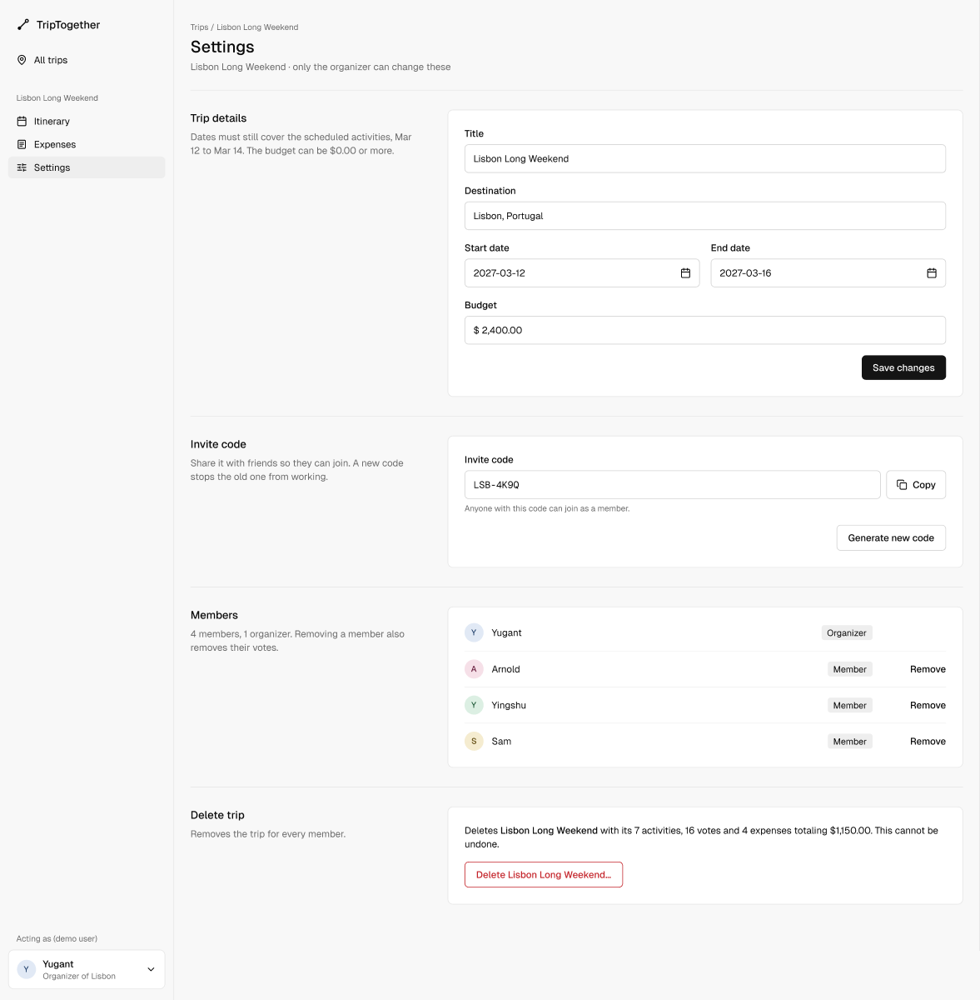

**Sections, top to bottom**

1. **Trip details.** The same `TripForm` as New Trip, saved with `PATCH /api/trips/:tripId`. The help text explains that the dates must still cover the scheduled activities (Mar 12 to Mar 14 in our sample data).
2. **Invite code.** Copy, and Generate new code, which replaces the code so the old one stops working.
3. **Members.** Each member with a role badge and Remove. Removing someone deletes their `trip_members` row and their votes. The organizer cannot be removed.
4. **Delete trip.** This comes last and spells out what will be lost: "7 activities, 16 votes and 4 expenses totaling $1,150.00." The button names the trip and opens a confirmation (see Wireframe 9). `DELETE /api/trips/:tripId` cascades to the related rows.

---

## Wireframe 8: Phone layouts

**Figma:** [08 Phone layouts](https://www.figma.com/design/lmCzu29AM6dYbE5vx587AV?node-id=9-980)

We designed the four most-used screens at 390px wide to make sure the layout works on a phone, since people often check trip plans on the go.

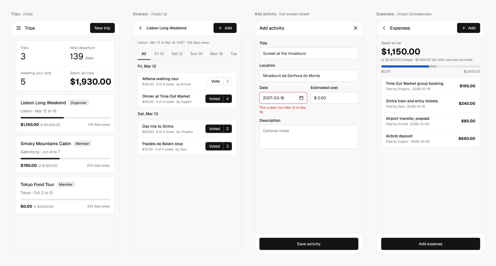

- The sidebar becomes a 56px top bar with the screen name, a back or menu button, and one action.
- The summary figures become a 2 by 2 grid.
- Day tabs scroll sideways inside their own row.
- Activity rows collapse to two lines: the title with the vote button, then cost, votes and who added it.
- Add activity becomes a full-screen sheet, and the main button is pinned to the bottom within thumb reach.
- Expense rows show the amount on the right and "Paid by" with the date under the description.

---

## Wireframe 9: States

**Figma:** [09 States](https://www.figma.com/design/lmCzu29AM6dYbE5vx587AV?node-id=10-879)

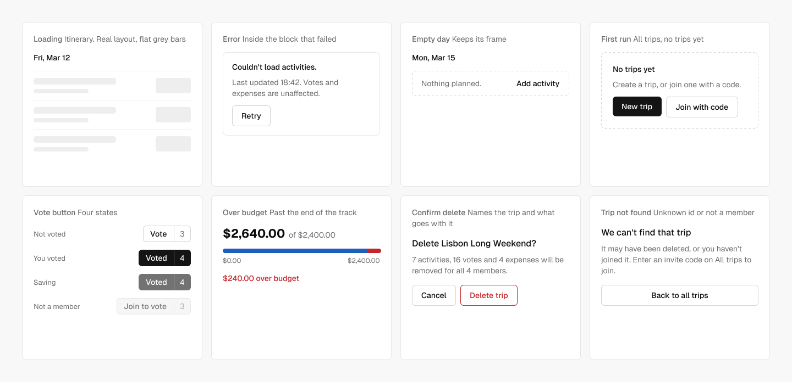

| State | Where | What the user sees |
|-------|-------|--------------------|
| Loading | Itinerary | The real layout with flat grey bars, so nothing jumps when data arrives |
| Error | Inside the block that failed | "Couldn't load activities." with the time it last loaded and a Retry button. The rest of the page keeps working |
| Empty day | Itinerary | The day keeps its card with "Nothing planned." and Add activity |
| First run | All Trips | "No trips yet" with New trip and Join with code |
| Vote button | Itinerary | Four states: Vote, Voted, Saving (dimmed while the request runs) and Join to vote (disabled for non-members) |
| Over budget | Expenses | The overrun shows in red past the end of the bar, with "$240.00 over budget" |
| Confirm delete | Settings | Names the trip and what goes with it: 7 activities, 16 votes and 4 expenses for all 4 members |
| Trip not found | Any trip route | "We can't find that trip" with a way back to All trips. Used for unknown ids and for non-members |

---

## Wireframe 10: User flow

**Figma:** [10 User flow](https://www.figma.com/design/lmCzu29AM6dYbE5vx587AV?node-id=10-880)

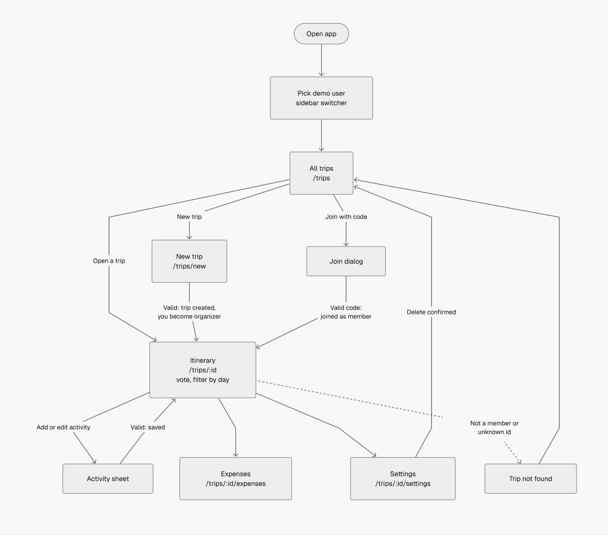

The app opens on All Trips after you pick a demo user. From there you can create a trip or join one with a code, and both paths land on the Itinerary. The Itinerary is the hub: the activity sheet, Expenses and Settings all open from it. Deleting a trip in Settings returns you to All Trips. Visiting a trip you are not a member of shows the trip-not-found state.

---

## Shared components

Every screen is built from the components on the Components page of the Figma file. Each one maps to a React component we plan to write.

| Figma component | Options in Figma | React component | Used on |
|-----------------|------------------|-----------------|---------|
| Sidebar | Screen: All trips, Itinerary, Expenses, Settings | `Sidebar`, `UserSwitcher` | all desktop pages |
| Button | Primary or Secondary, label, optional plus icon | `Button` | all pages |
| VoteButton | Vote or Voted, count | `VoteButton` | Itinerary, States |
| ActivityRow | votes 1 to 4, title, detail, cost, own (shows Edit and Delete), top (shows Most votes) | `ActivityCard` | Itinerary, Add Activity |
| ExpenseRow | own or not, description, payer, date, amount | `ExpenseRow` | Expenses |
| Avatar | Yugant, Arnold, Yingshu, Sam | `Avatar` | all pages |
| Badge | label | `Badge` | trip cards, members |

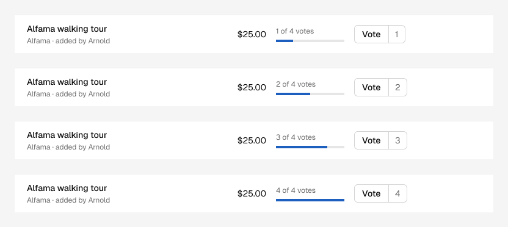

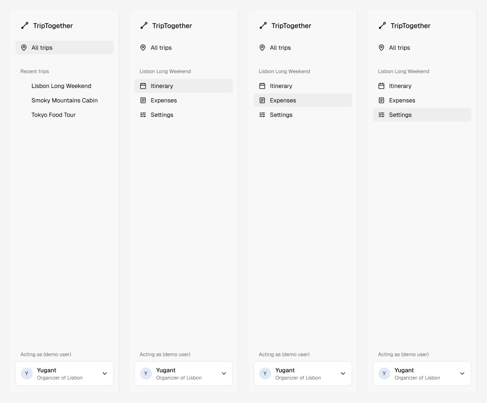

Other components we will build in React, shown inside the screens above: `TripCard`, `DayTabs`, `ActivityList`, `ActivityFormSheet`, `BudgetBar`, `ExpenseForm`, `MemberList`, `InviteCode`, `JoinTripDialog`, `TripForm`, `ConfirmDialog`, `EmptyState`, `ErrorBlock` and `TripNotFound`.

---

## Design tokens

These are stored as variables and text styles in the Figma file. We will copy them into CSS custom properties so the code matches the design.

**Colors**

| Token | Value | Use |
|-------|-------|-----|
| `bg/ground` | `#f8f8f8` | page background, sidebar |
| `bg/surface` | `#ffffff` | cards, inputs |
| `bg/raised` | `#eeeeee` | active nav item, badges, skeletons |
| `bg/secondary` | `#e5e5e5` | secondary buttons |
| `line/border` | `#e6e6e6` | card borders |
| `line/rule` | `#f0f0f0` | dividers between rows |
| `line/control` | `#d4d4d4` | input and outline button borders |
| `text/primary` | `#0a0a0a` | main text |
| `text/muted` | `#6b6b6b` | secondary text |
| `text/negative` | `#c4242a` | errors, destructive actions, over budget |
| `accent/ink` | `#141414` | primary buttons, Voted state, budget bars |
| `data/spent` | `#1d5fbf` | votes meter, money spent |
| `data/planned` | `#bdbdbd` | planned activity costs |
| `data/track` | `#e6e6e6` | empty part of bars |

Each member also has a pale avatar color: Yugant blue, Arnold pink, Yingshu green and Sam yellow.

**Type** (Geist for everything, Geist Mono for invite codes)

| Style | Size / line height | Weight | Use |
|-------|--------------------|--------|-----|
| Title | 24 / 32 | Medium | page titles |
| Section | 16 / 24 | Medium | card titles, trip names |
| Body | 14 / 20 | Regular | most text |
| Body/Medium | 14 / 20 | Medium | labels, row titles, text buttons |
| Body/Bold | 14 / 20 | Bold | money in tables |
| Label | 13 / 18 | Regular | meta text, badges |
| Caption | 12 / 16 | Regular | help text, breadcrumbs |
| KPI | 30 / 36 | Regular | summary numbers |
| KPI/Money | 30 / 36 | Bold | headline money |
| Money/Large | 22 / 28 | Bold | budget snapshot |
| Mono | 14 / 20 | Regular | invite codes |

**Spacing and shape:** 256px sidebar, 24px page padding, 12px gaps between cards, 20px card padding, 8px card radius and 6px control radius. Buttons are 36px tall.

---

## API calls by screen

| Screen | Calls |
|--------|-------|
| Sidebar | `GET /api/users` for the demo user selector |
| All Trips | `GET /api/trips?userId=` |
| Join dialog | `POST /api/trips/join` |
| New Trip | `POST /api/trips` |
| Itinerary | `GET /api/trips/:tripId`, `GET /api/trips/:tripId/activities`, `GET /api/trips/:tripId/members`, `POST` and `DELETE /api/activities/:activityId/votes` |
| Activity sheet | `POST /api/trips/:tripId/activities`, `GET`, `PATCH` and `DELETE /api/activities/:activityId` |
| Expenses | `GET` and `POST /api/trips/:tripId/expenses`, `PATCH` and `DELETE /api/expenses/:expenseId` |
| Settings | `PATCH /api/trips/:tripId`, `POST /api/trips/:tripId/invite-code`, `DELETE /api/trips/:tripId/members/:userId`, `DELETE /api/trips/:tripId` |

The activity routes match the README. The others follow the same REST pattern and will be finalized when we build the Express routes.

---

## Decisions and open questions

**Decided while designing**

- Activities without a date are allowed and appear as Unscheduled ideas. This means `activities.scheduled_date` is nullable.
- Edit and Delete appear only on rows the active user created. The server checks this as well, not just the UI.
- Votes save immediately and roll back if the request fails.
- Organizer-only actions live on the Settings page so the itinerary stays focused on planning.
- The selected day filter lives in the URL.

**Still open for the team**

- Should Settings be a separate route, or a tab on the trip page? The wireframes assume a separate route.
- Should regenerating the invite code be in the first version, or stretch work?
- How much of the phone layout do we build for the demo, beyond making sure nothing breaks at small widths?
